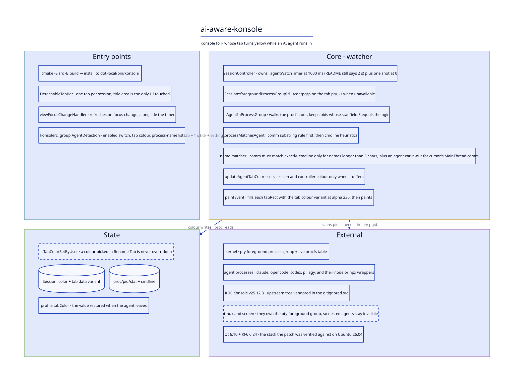

# HUMANS

**AI-aware Konsole** is a four-file patch on top of KDE Konsole that paints a session's tab
yellow while an AI agent is running in that tab, and puts it back the moment the agent exits.

Read it left to right:

- **This repo is the patch, not the terminal.** `agent-tab-color.patch` is the artifact and
  `src/` is a gitignored clone of upstream Konsole v25.12.3, so a fresh clone here has
  nothing to build until you clone Konsole and `git apply` the patch.
- **Detection is per process group, not per binary name.** `SessionController` asks the pty
  for its foreground process group (`tcgetpgrp`) and then walks `/proc` for *any* pid in
  that group, which is why `bash → npx → claude` still lights up; the flip side is that
  `tmux` and `screen` own the foreground group themselves, so agents inside them are
  invisible.
- **Three fallbacks, cheap to expensive:** the group scan, then the foreground pid, then the
  foreground process name. Comm must match a listed name exactly; cmdline is only searched
  for names longer than three characters (so `pi` and `agy` cannot match by substring), and
  the literal name `agent` is special-cased to `/agent` or `bin/agent` because cursor's CLI
  reports its comm as `MainThread`.
- **It never fights the user.** A tab colour picked in the Rename Tab dialog is left alone,
  the colour is only written when it actually differs, and the restore target is the
  profile's own `tabColor`, so an exit is not "back to default" but "back to yours".
- **The blink is a repaint, not a highlight.** `DetachableTabBar::paintEvent` fills the whole
  `tabRect` from the tab's colour variant at alpha 235 before Qt paints the title, so the
  wash covers the entire title area instead of a thin stripe. Note the code polls at
  1000 ms while the README still says 2 s.

Under the hood: [`docs/system.d2`](docs/system.d2) (TALA layout, strokes-only styles) renders
to `docs/system.svg` + `docs/system.png` via [`scripts/render-diagram.sh`](scripts/render-diagram.sh).
